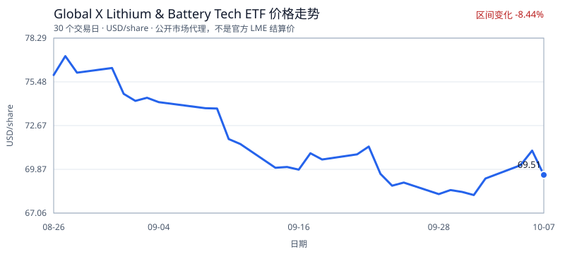

# Pilgangoora 锂矿矿权日报

> 生成时间：2026-10-08 16:10 UTC  
> 数据截止日：2026-10-08  
> 数据状态：存在降级，详见风险提示

## 执行摘要

近 30 天检索到 3 条可验证日期的相关报道。
资源报告按 JORC 标识，提取到 2 条目标分类记录。
价格代理工具返回 30 个收盘观察值，区间变化 -8.44%。

## 新闻摘要

- [September 2026 Quarterly Activities Report advisory](https://www.asx.com.au/asx/v2/statistics/displayAnnouncement.do?display=pdf&idsId=03142755)（ASX: PLS，2026-09-23）：PLS 向澳大利亚证券交易所提交的公司公告。
- [What Lithium Prices Mean for ASX Battery Materials Stocks Pilbara Minerals (ASX:PLS), Liontown (ASX:LTR) and Elevra Lithium (ASX:ELV) - Kalkine](https://news.google.com/rss/articles/CBMi7wFBVV95cUxOUTR0WXU2R2FabkhXaE42cENaM3RBaHg5bVBjY01yMmJGQkEyR1F6UFp5eUpzQ3J4T3pBUDFDLTUwVC1VX1dnVWtUSzQ1SGlmamFBaXBLaXdZMEZ5SGpvWkNuNmQ5aUk4dUV0QjJQSUE3NzgwLVFPMVRTWWxZdlVpZXBzLWNUaC1YVWF3Z2ljSTRFc3dnQmMwRExsZ1VhMkJwTnh3NEV3OUdOZmo0SFhGaDNFNXRZZzAxV2c5a2ZOeTI2WExZWDdOMEdhNjBXeGphVTdkWHNVODJrTlUwZUducldJSzZRbEs1RFM1MFZUSQ?oc=5)（Kalkine，2026-09-16）：What Lithium Prices Mean for ASX Battery Materials Stocks Pilbara Minerals (ASX:PLS), Liontown (ASX:LTR) and Elevra Lithium (ASX:ELV) Kalkine
- [Pilbara Minerals (ASX:PLS) Up 129% in a Year: Is the Lithium Rally Still Worth Watching? - Kalkine](https://news.google.com/rss/articles/CBMiuAFBVV95cUxPZjZHWUxyeXJvS3F2UDZ1U3ktNjVXNVFLNGhOUTB6NmppM0IwLVFTbXR0cmNfMDM2NnNmVFg1X1FvVjY2Y0dNd1lfS1MzcFRkUWJGZjZVM09RU1FWNWRSbjlSajVRM2c2bGttS0Ntbi1MMnBBNGt0ejdRdFVDdDB1clBQWnJzekxjYzkyV1g4cnZkWE4wVmR5MTdpbFJLMHREZ0E3SzdLTFlfb1pXRTFoSVhhYVhzc2ZU?oc=5)（Kalkine，2026-09-11）：Pilbara Minerals (ASX:PLS) Up 129% in a Year: Is the Lithium Rally Still Worth Watching? Kalkine

## 储量数据

> 口径说明：Indicated / Inferred 属于矿产资源量分类，并非 Proven / Probable 矿石储量。

| 分类 | 矿石量 | 品位 | 金属量 | 页码 | 置信度 |
|---|---:|---:|---:|---:|---:|
| Indicated | 356.00 Mt | 1.29 % Li2O | 4.60 Mt Li2O | 2 | 90% |
| Inferred | 70.00 Mt | 1.25 % Li2O | 0.90 Mt Li2O | 2 | 90% |

来源：[资源报告 PDF](https://announcements.asx.com.au/asxpdf/20250611/pdf/06kmc3l7r1bjsm.pdf)。

## 价格走势

最近可用收盘：2026-10-07，69.5100 USD/share（Global X Lithium & Battery Tech ETF）。
窗口首尾：2026-08-26 的 75.9200 → 2026-10-07 的 69.5100，变化 -8.44%。

| 指标 | 数值 |
|---|---:|
| 观察值 | 30 个交易日 |
| 区间最高 | 77.1300 USD/share（2026-08-27） |
| 区间最低 | 68.2200 USD/share（2026-10-01） |
| 区间变化 | -8.44% |

> 图表口径：公开市场代理走势，不代表官方 LME 结算价或锂现货价格。
来源：[行情接口与具体合约](https://api.nasdaq.com/api/quote/LIT/historical?assetclass=etf&fromdate=2020-01-01&limit=5000)。

## 风险提示

- 新闻源 www.mining.com 暂不可用：上游返回 HTTP 403
- 该报告未标识为 NI 43-101，提取结果不得表述为 NI 43-101 数据。
- 使用了在 2026-10-08 对照原始链接核验的文本快照，本次未实时下载 PDF。
- 该行情是公开市场代理，不是官方 LME 结算价；报告已明确标注来源和金融工具。
- 区间日收益率波动率（总体标准差）为 1.2034%。
- 请求日期没有行情，已返回 2026-10-07 的最近前收盘价。
- 本简报是信息聚合结果，不构成投资、法律或矿业技术意见。

## 来源索引

1. [September 2026 Quarterly Activities Report advisory](https://www.asx.com.au/asx/v2/statistics/displayAnnouncement.do?display=pdf&idsId=03142755)
2. [What Lithium Prices Mean for ASX Battery Materials Stocks Pilbara Minerals (ASX:PLS), Liontown (ASX:LTR) and Elevra Lithium (ASX:ELV) - Kalkine](https://news.google.com/rss/articles/CBMi7wFBVV95cUxOUTR0WXU2R2FabkhXaE42cENaM3RBaHg5bVBjY01yMmJGQkEyR1F6UFp5eUpzQ3J4T3pBUDFDLTUwVC1VX1dnVWtUSzQ1SGlmamFBaXBLaXdZMEZ5SGpvWkNuNmQ5aUk4dUV0QjJQSUE3NzgwLVFPMVRTWWxZdlVpZXBzLWNUaC1YVWF3Z2ljSTRFc3dnQmMwRExsZ1VhMkJwTnh3NEV3OUdOZmo0SFhGaDNFNXRZZzAxV2c5a2ZOeTI2WExZWDdOMEdhNjBXeGphVTdkWHNVODJrTlUwZUducldJSzZRbEs1RFM1MFZUSQ?oc=5)
3. [Pilbara Minerals (ASX:PLS) Up 129% in a Year: Is the Lithium Rally Still Worth Watching? - Kalkine](https://news.google.com/rss/articles/CBMiuAFBVV95cUxPZjZHWUxyeXJvS3F2UDZ1U3ktNjVXNVFLNGhOUTB6NmppM0IwLVFTbXR0cmNfMDM2NnNmVFg1X1FvVjY2Y0dNd1lfS1MzcFRkUWJGZjZVM09RU1FWNWRSbjlSajVRM2c2bGttS0Ntbi1MMnBBNGt0ejdRdFVDdDB1clBQWnJzekxjYzkyV1g4cnZkWE4wVmR5MTdpbFJLMHREZ0E3SzdLTFlfb1pXRTFoSVhhYVhzc2ZU?oc=5)
4. [资源报告 PDF](https://announcements.asx.com.au/asxpdf/20250611/pdf/06kmc3l7r1bjsm.pdf)
5. [Global X Lithium & Battery Tech ETF](https://api.nasdaq.com/api/quote/LIT/historical?assetclass=etf&fromdate=2020-01-01&limit=5000)
